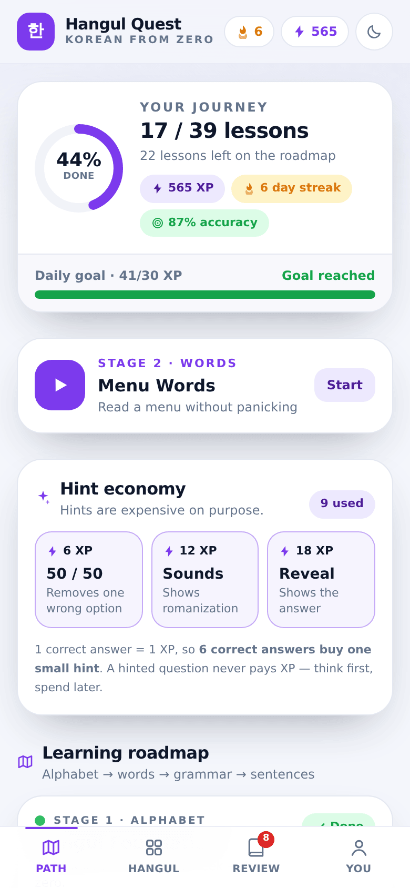
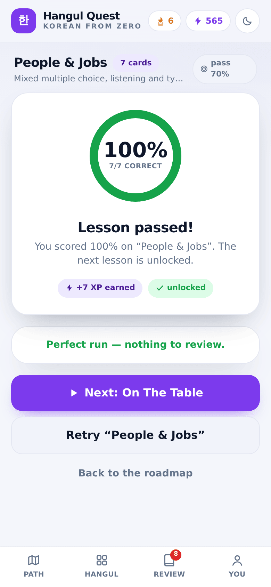
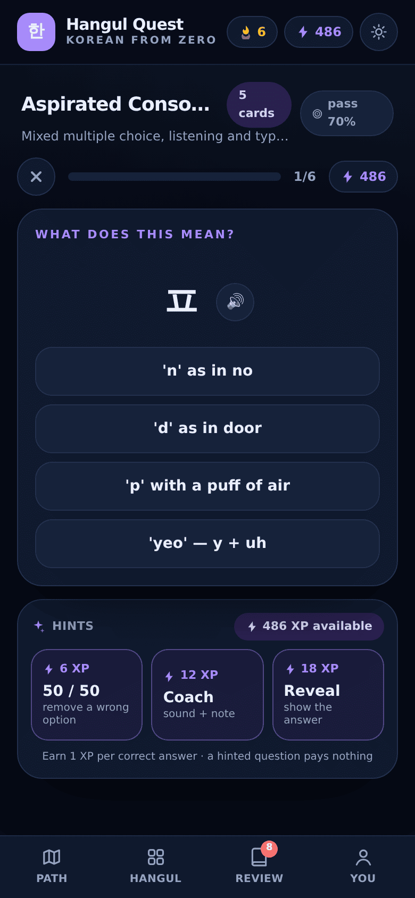
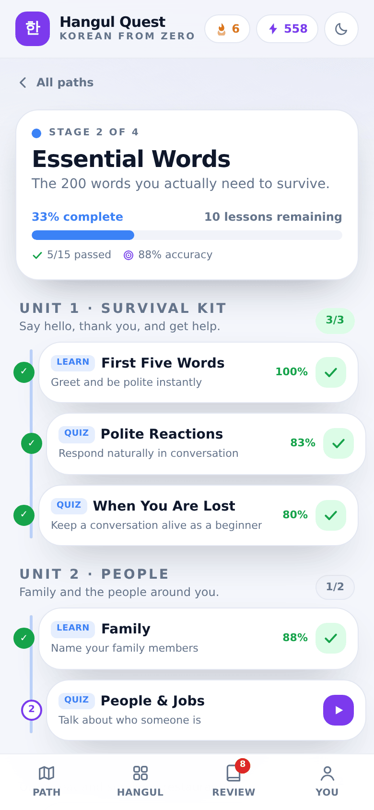
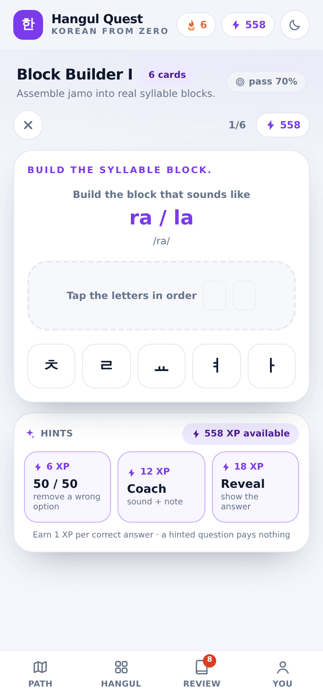
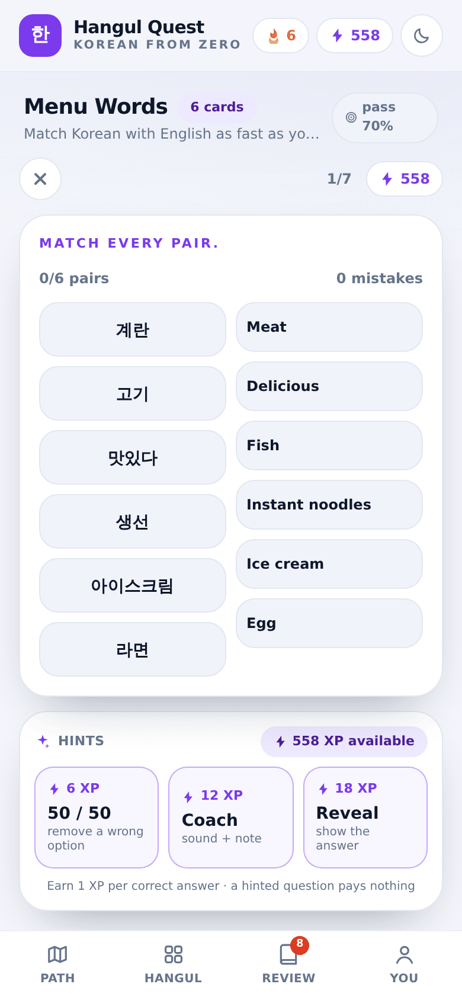
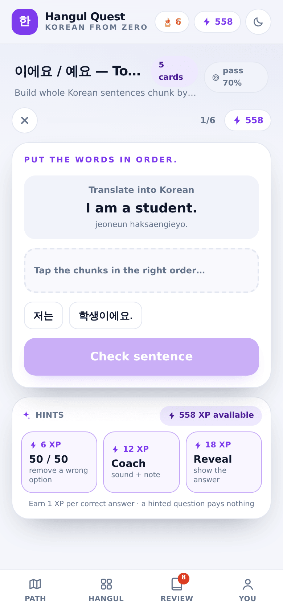

<div align="center">

# Hangul Quest

**Learn Korean from absolute zero — a four-stage roadmap, 39 lessons, 247 cards and 8 exercise types, wrapped in a game economy you have to earn.**

[](https://github.com/seyedmohammadsinahosseini/hangul-path/actions/workflows/ci.yml)
[](https://nextjs.org)
[](https://react.dev)
[](https://flutter.dev)
[](https://www.postgresql.org)
[](LICENSE)

**English** · [فارسی](docs/README.fa.md)





</div>

## What this is

Hangul Quest is a beginner Korean course that teaches the writing system first, then survival
vocabulary, then grammar and finally whole conversations — in English, mobile-first, no login.
A lesson only counts once you score **≥ 70 %**, so the roadmap is a record of what you actually
learned rather than what you clicked through.

Two clients share the same curriculum and the same rules:

| | Folder | Stack | Runs |
|---|---|---|---|
| **Web app** | [`web/`](web) | Next.js 16 · React 19 · TypeScript · Tailwind 4 · Drizzle ORM · PostgreSQL | Server-side progress, XP economy, leaderboard, REST API |
| **Mobile app** | [`mobile/`](mobile) | Flutter 3.27+ · Dart · `shared_preferences` · `flutter_tts` | Fully offline, same 39 lessons and rules, on-device persistence |

## Features

**Curriculum — four gated stages**

| Stage | Path | Units | Lessons | Opens when |
|---|---|---|---|---|
| 1 | Hangul Foundations | 3 | 11 | always |
| 2 | Essential Words | 6 | 15 | pass the Hangul Mastery Test (or finish 70 % of stage 1) |
| 3 | Grammar Engine | 3 | 9 | 4 vocabulary lessons at ≥ 70 % accuracy |
| 4 | Real Conversations | 3 | 4 | 3 grammar lessons at ≥ 70 % accuracy |

**Eight exercise types** — flashcards with tap-to-reveal, Korean → English, English → Korean,
romanization reading, listening (Korean text-to-speech), typing the romanization, the
**Syllable Builder** (assemble jamo into real blocks using the U+AC00 composition maths) and the
**Sentence Builder** (order word chunks into a sentence).

**The game economy is the point, not a sticker**

- **1 XP per un-hinted correct answer.** Small hint costs 6 XP, Coach 12 XP, Reveal 18 XP — and a
  hinted question pays nothing. Six correct answers buy six points; six wrong ones buy one hint.
- **70 % mastery gating** — retries are cheap, skipped understanding is not.
- **Review Deck** with spaced recall: a missed card returns until it is recalled correctly three
  times in a row, then it is retired as *mastered*.
- Daily goal and streak (with a one-day grace window), 8 achievements, leaderboard, light/dark theme.

<div align="center">




</div>

## Repository layout

```
.
├── web/                  Next.js application (server + client)
│   ├── src/app/          App Router pages and REST handlers (api/state, api/action, …)
│   ├── src/lib/          curriculum.ts · quiz.ts (question generator) · engine.ts (XP rules)
│   ├── src/db/           Drizzle schema and pool
│   ├── drizzle/          SQL migrations (generated, committed)
│   ├── scripts/seed-demo.ts   one-command demo learner
│   └── tests/            Vitest suite for the curriculum and the question generator
├── mobile/               Flutter application (offline)
│   └── lib/{data,logic,models,screens,state,services,widgets}/
├── docs/                 architecture · roadmap · deployment · screenshots
└── .github/workflows/    CI: lint, typecheck, test, build
```

## Quickstart — web

Requires **Node 20+** and a **PostgreSQL** database.

```bash
git clone https://github.com/seyedmohammadsinahosseini/hangul-path.git
cd hangul-path/web

cp .env.example .env          # then point DATABASE_URL at your Postgres
npm install
npm run db:migrate            # apply the committed migrations
npm run db:seed               # optional: demo learner + leaderboard data
npm run dev                   # http://localhost:3000
```

`npm run db:seed` creates a deterministic demo account. The app is auth-less on purpose: the
browser gets an `hq_handle` cookie and the server upserts one profile per handle. To open the
seeded profile, set that cookie (`hq_handle=demo-learner`) — or simply browse as a fresh guest.

| Script | What it does |
|---|---|
| `npm run dev` / `build` / `start` | Next.js dev server, production build, production server |
| `npm run test` | Vitest suite (curriculum integrity, XP/pass rules, question generation) |
| `npm run lint` · `npm run typecheck` | ESLint · `tsc --noEmit` |
| `npm run db:generate` · `db:migrate` · `db:push` | Drizzle Kit migrations |
| `npm run db:seed` | Insert the demo learner |

## Quickstart — mobile

Requires **Flutter 3.27+**.

```bash
cd mobile
flutter create . --project-name hangul_quest --org com.hangulquest --platforms android,ios
flutter pub get
flutter run                   # or: ./setup.sh — runs the two steps above and patches TTS permissions
```

The Flutter app keeps its own copy of the curriculum so it works with no network at all; progress
lives in `shared_preferences`. `AppState` is the single seam to swap local persistence for the
web API if you want the two clients to share a profile. See [`mobile/README.md`](mobile/README.md).

## API

All handlers live under `web/src/app/api/`. The client is a thin view over them — progress, XP,
streaks, unlocks and the review deck are computed and stored server-side.

| Endpoint | Method | Purpose |
|---|---|---|
| `/api/state` | `GET` | Full learner state: profile, per-path/lesson progress, review deck, achievements |
| `/api/state` | `POST` | Create/refresh the profile (optional `displayName`) |
| `/api/action` | `POST` | `lesson` · `review` · `hint` · `profile` · `reset` — the only way XP moves |
| `/api/leaderboard` | `GET` | Ranks by XP with accuracy and the caller's own position |
| `/api/health` | `GET` | Database liveness probe (used by CI and by deploy platforms) |

```bash
curl -s localhost:3000/api/state | jq '.profile, .overallPercent'
curl -s -X POST localhost:3000/api/action -H 'content-type: application/json' \
  -d '{"type":"lesson","lessonId":"h-v1","answers":[{"cardId":"h-v1-1","correct":true,"hint":null}]}'
```

## Testing & CI

```bash
cd web && npm run test        # 13 tests: id integrity, pass marks, RNG determinism, distractors
```

`.github/workflows/ci.yml` runs lint, typecheck, the Vitest suite and a production build (with a
throwaway `DATABASE_URL`, since the database is only contacted at runtime).

## Design notes

- **Deterministic question generation.** A seeded PRNG keyed by `lessonId:attempt` means a session
  is reproducible while a retry is genuinely different — and the generator is unit-testable.
- **Server-authoritative economy.** Score, pass/fail, XP, unlock rules and the review deck are all
  derived in `web/src/lib/engine.ts`; the client never computes its own XPS. Answer *correctness* is
  still reported by the client today, which is the first thing a real multiplayer build should sign
  server-side (see the roadmap).
- **Content as data.** Every lesson is a typed literal in `curriculum.ts` (web) and
  `curriculum_data.dart` (mobile); adding a lesson adds no UI work.

More depth in [`docs/ARCHITECTURE.md`](docs/ARCHITECTURE.md), deployment steps in
[`docs/DEPLOYMENT.md`](docs/DEPLOYMENT.md), and what comes next in [`docs/ROADMAP.md`](docs/ROADMAP.md).

## Author

**Seyed Mohammad Sina Hosseini** — [github.com/seyedmohammadsinahosseini](https://github.com/seyedmohammadsinahosseini)

## License

[MIT](LICENSE) © 2026 Seyed Mohammad Sina Hosseini
